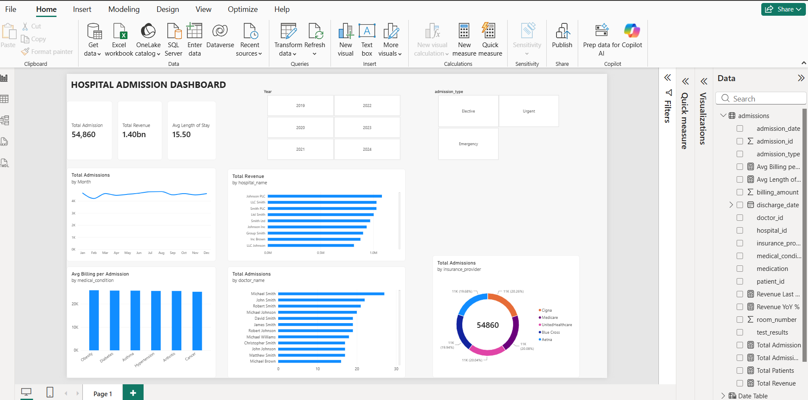

# Hospital Admissions Dashboard (SQL Server + Power BI)

## Overview
An end-to-end analytics project: raw CSV → SQL Server (cleaning and
modelling) → Power BI dashboard.

**Note:** The dataset is synthetic, not real hospital data.

## Data Cleaning (SQL Server)
- Raw rows imported: 55,500
- Duplicate rows removed: 532
- Negative billing amounts removed: 108
- Clean rows used in the dashboard: 54,860

## Data Model
The flat CSV was split into four related tables with primary and
foreign keys: patients, doctors, hospitals, admissions.
Five SQL views support the analysis (revenue by hospital, admissions
by month, top doctors, average stay by condition, insurance share).

## Dashboard
- KPIs: Total Admissions, Total Revenue, Average Length of Stay
- Admissions by month
- Revenue by hospital
- Average billing by medical condition
- Admissions by doctor
- Insurance provider share
- Slicers: Year and Admission Type

## Limitations
- The dataset has no patient ID, so a patient is defined as a unique
  combination of name, age, gender and blood type.
- The data is synthetic, so monthly admissions look flat, unlike real
  hospitals where seasonality is common.

## Files
- `hospital_db_setup.sql` – database setup, cleaning, tables, views
- `Hospital_Dashboard.pbix` – Power BI report
- `dashboard.png` – dashboard screenshot
- `healthcare_dataset.csv` - source dataset (synthetic)

## Tools
SQL Server, SSMS, Power BI, DAX
